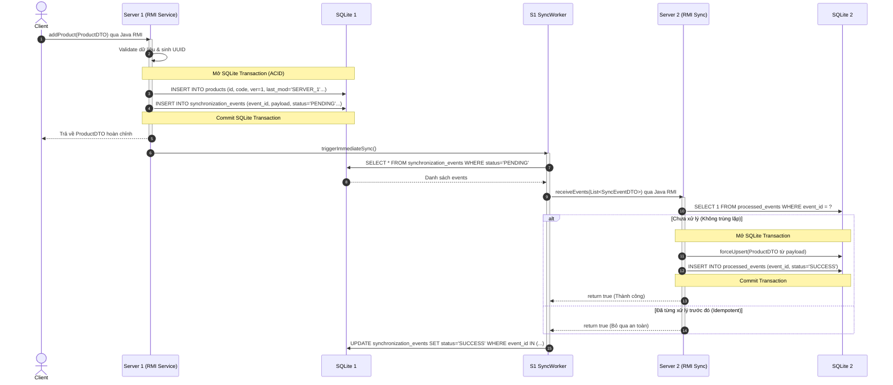
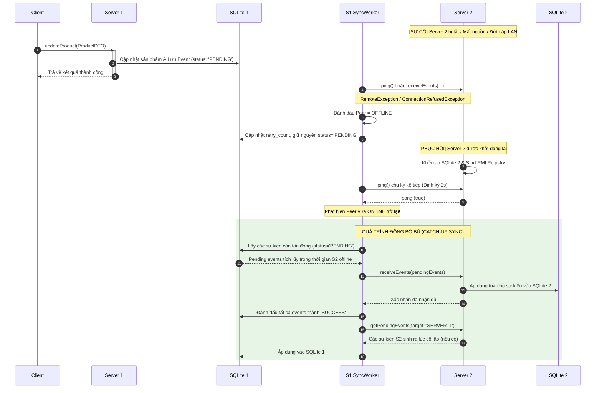
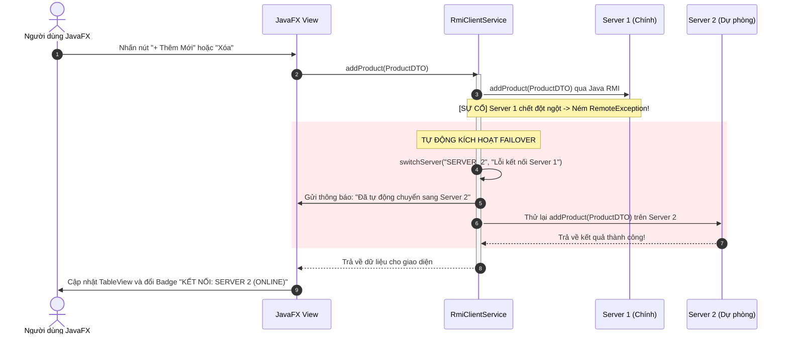
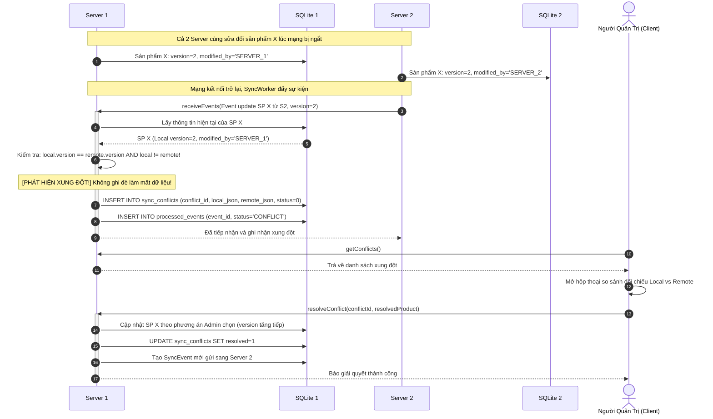

# SƠ ĐỒ TUẦN TỰ (SEQUENCE DIAGRAMS)

Tài liệu mô tả chi tiết các luồng giao tiếp mạng và đồng bộ dữ liệu giữa Client và 2 Server sử dụng Mermaid Sequence Diagrams.

---

## 1. LUỒNG ĐỒNG BỘ 2 CHIỀU THỜI GIAN THỰC (SERVER 1 ➔ SERVER 2)

Kịch bản: Client kết nối tới Server 1 và thêm mới hoặc sửa đổi một sản phẩm trong kho.

---

## 2. LUỒNG XỬ LÝ SERVER MẤT KẾT NỐI VÀ ĐỒNG BỘ BÙ (CATCH-UP SYNC)

Kịch bản: Server 2 bị tắt hoặc đứt mạng LAN. Server 1 vẫn tiếp tục phục vụ Client. Khi Server 2 khởi động lại, hai Server tự động trao đổi các sự kiện còn thiếu.

---

## 3. LUỒNG CHUYỂN ĐỔI DỰ PHÒNG TỰ ĐỘNG (CLIENT TRANSPARENT FAILOVER)

Kịch bản: Client đang kết nối với Server 1, Server 1 đột ngột ngừng hoạt động. Client tự động phát hiện lỗi và chuyển đổi cuộc gọi sang Server 2 mà không làm gián đoạn người dùng.

---

## 4. LUỒNG PHÁT HIỆN VÀ GIẢI QUYẾT XUNG ĐỘT DỮ LIỆU ĐỒNG THỜI

Kịch bản: Trong lúc bị phân rã mạng, Client A sửa giá sản phẩm X trên Server 1, Client B đồng thời sửa tồn kho sản phẩm X trên Server 2. Khi tái kết nối, xung đột được phát hiện và xử lý.

